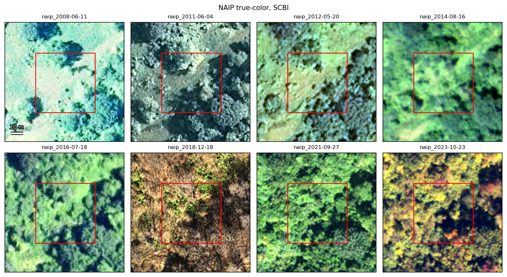
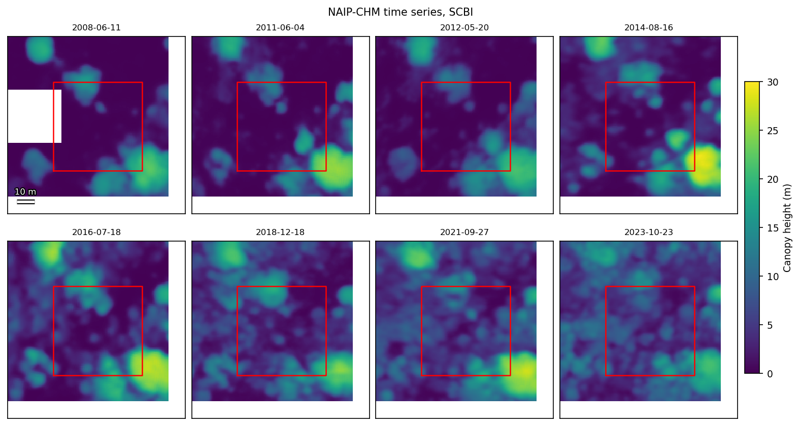
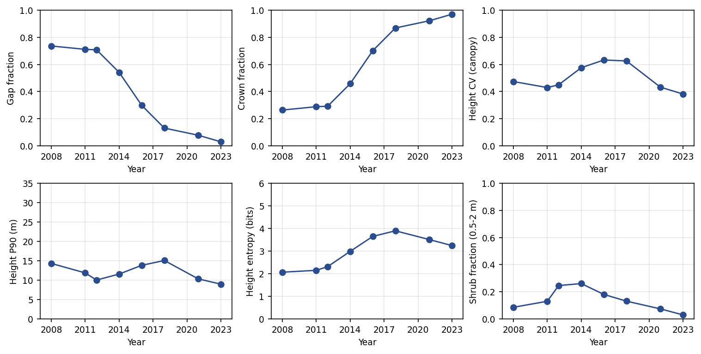
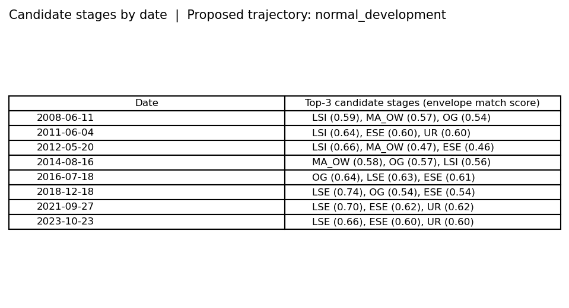

# CSDV: Eastern US Forest Disturbance and Recovery Mapping

This repository develops a method for mapping forest disturbance and post-disturbance recovery across the eastern United States from multi-temporal NAIP aerial imagery (0.6 m, four-band RGBN). The work is carried out by a university remote sensing group as a sub-contract to a forest disturbance mapping project funded by the USDA Natural Resources Conservation Service through Pheasants Forever.

The method has two parts. The first maps where and when canopy was lost, at the scale of single stands, and names the cause. The second describes what the stand does afterwards: it extracts stand-level structural metrics from NAIP and NAIP-derived canopy height models, assigns each stand an Oliver-Larson developmental stage at every imagery date, and tracks how those stages change through time.

The central idea is that 0.6 m imagery resolves individual tree crowns and canopy gaps, which connects directly to decades of stand development theory. Crown width distributions, gap fraction, and texture measured from NAIP can be compared against established expectations for how forest structure changes through development. Departures from those expectations become diagnostic of specific disturbance types, management histories, and recovery outcomes.

## Status

Updated November 2026. The project is in development, and everything here is preliminary and unpublished.

**Disturbance mapping is the active work.** A model that reads two NAIP dates and marks canopy loss is trained on labels produced without a photo interpreter, and it now maps blocks of adjoining 7.5 minute quads on a cluster. The first regional maps (Southern Indiana, western North Carolina, south Georgia, Vermont) are being produced and have not been assessed for accuracy yet.

**The recovery classification is a paused proof of concept.** The code checks whether the structural metrics the classifier needs can be extracted from NAIP and whether they separate developmental stages. The metrics are evaluated against airborne lidar benchmarks at NEON sites (SCBI in Virginia, Harvard Forest in Massachusetts, Talladega in Alabama). The classification thresholds and rule logic have not been calibrated, so all stage and trajectory assignments shown below are tentative illustrations of the workflow and not validated results.

## How disturbance is mapped

The map is built in four steps. Each has a command group in the `csdv` command line tool and a guide under `docs/guides/`.

| Step | What it does | Command | Guide |
|---|---|---|---|
| 1. Candidates | A NAIP-derived canopy height model is made for every NAIP year of a quad. A Disturbance Index on the heights of consecutive dates proposes where canopy was lost | `csdv grid`, `csdv detect-disturbance` | [Grid processing](docs/guides/grid_processing.md), [Disturbance detection](docs/guides/disturbance_detection.md) |
| 2. Labels | Two vision-language models look at each candidate on every image date and say whether canopy was lost, when, and from what cause. Where they agree, the answer becomes a training label. A person reads a blind sample to measure the label error | `csdv label`, `csdv audit` | [Disturbance labels](docs/guides/disturbance_labels.md), [Label audit](docs/guides/label_audit.md) |
| 3. Pair model | A Siamese network reads the four NAIP bands of two dates and returns the probability of canopy loss and its cause for every 9.6 m cell. The height model proposes and constrains the labels and is never an input | `csdv pair` | [Pair model](docs/guides/pair_model.md) |
| 4. Maps and review | The pair model maps every pair of consecutive dates of a quad. The maps are read in a browser, over the imagery, with notes | `csdv grid queue`, `csdv grid webmap`, `csdv view`, `csdv review` | [Map viewer](docs/guides/map_viewer.md), [Disturbance review](docs/guides/disturbance_review.md) |

Preliminary results, November 2026. Two label rounds produced about 4,200 loss events in 124 places across the contiguous United States. On 20 places held back from training, labels spread over many small places raised the average precision of the pair model from 0.66 to 0.80 (mean of four training seeds). In a blind reading of 25 loss labels, one was wrong. Known weaknesses are false alarms on leaf-off and snow-covered images, recovered defoliation read as loss, and the cause of wind and insect damage, which the model does not yet name on places it has not seen.

A mapped loss patch is meant to carry its date interval, cause and severity to the recovery classification described next. That link is not built yet.

## How the recovery classification works

### Layer 1: Ecological stratification

Forest structure at a given developmental stage depends on the site. A productive cove and a dry ridge reach canopy closure at different rates and settle at different structural conditions. Every location is therefore assigned one of 13 site types defined by landscape position, parent material, topographic wetness, and soils. Classification thresholds are expressed relative to each site type rather than as fixed absolute values.

| Group | Site types |
|---|---|
| Hydric and riparian | Floodplain / riparian hydric; upland seep / depression hydric |
| Low-relief wet | Wet-mesic flats / lake plain clay |
| Glacial and sandy | Glacial sand plain / outwash xeric |
| Upland mesic | Till upland mesic; cove / concave mesic; lower slope / bench mesic |
| Mountain | Upper slope north-facing cool mesic; ridge / convex xeric; south-facing xeric slope; toe-slope / hollow wet mesic |
| Geologic productivity | Limestone / karst mesic-productive; sandstone / shale upland dry-mesic |

### Layer 2: Stand development stage

At each NAIP date, a stand is assigned one of seven developmental stages from the Oliver-Larson stand dynamics model. Each stage has a characteristic structural signature in the metrics.

| Stage | Code | Structural signature |
|---|---|---|
| Early Stand Initiation | ESI | Open ground, scattered seedlings, very high gap fraction |
| Late Stand Initiation | LSI | Woody plants establishing, shrub layer present, gap fraction declining |
| Early Stem Exclusion | ESE | Canopy closing, crown fraction rising, competition and self-thinning beginning |
| Late Stem Exclusion | LSE | Dense uniform canopy, low gap fraction, low crown size variability, low entropy |
| Understory Reinitiation | UR | Crown size variability and entropy rising, small gaps forming, understory developing |
| Mature Forest / Open Woodland | MA/OW | Stable moderate-to-high heterogeneity; gap persistence separates closed forest from open woodland |
| Old Growth | OG | High crown size variability, broad crown size distribution, persistent heterogeneity |

### Layer 3: Trajectory

The classifier then tracks how stage assignments change across the full NAIP record. A sequence that follows the expected progression for its site type is normal development. Sequences that depart from it are assigned to one of four trajectory groups.

| Trajectory group | What it captures | Representative classes |
|---|---|---|
| Development stagnation | Stand stays in a stage longer than expected or fails to gain expected structural complexity | Beech bark disease sprout trap; chronic defoliation stagnation |
| Tree establishment failure | Tree crowns fail to develop after disturbance because herb or shrub cover persists | Fern / graminoid dominance; ericaceous shrub thicket |
| Non-forest land conversion | Conditions stay persistently non-forest and outside all stage envelopes | Agriculture; pasture; development; surface mining; utility corridor |
| Undesirable forest type conversion | Forest develops, but with structure that departs from natural stands | Invasive tree dominance; row-structured plantation; even-aged plantation |

A parallel vocabulary describes the disturbances and management activities that drive these transitions, grouped into harvest types (for example clearcut, shelterwood, thinning), natural disturbances (wind, fire, insect and disease, drought), and post-disturbance management flags (planting, salvage, scarification).

## Primary diagnostic metrics

The system inventories many candidate metrics. A smaller set appears most often in the classification logic and drives the worked example below.

| Metric | Source |
|---|---|
| Gap fraction | NAIP-CHM height threshold |
| Crown fraction | NAIP-CHM height threshold |
| Crown width CV | Crown segmentation |
| Crown width P90 | Crown segmentation |
| Texture entropy | GLCM on NAIP pixel values |
| Shrub / low woody fraction | NAIP spectral and height bands |
| Gap persistence | Multi-temporal CHM threshold |
| Linearity index | Spatial pattern on the gap mask |

## Example: closing canopy at SCBI, 2008 to 2023

This example walks through the full workflow for a single 50 m window at the SCBI NEON site in northern Virginia, on a mesic till upland. Eight NAIP dates span 2008 to 2023. The disturbance that reset this stand predates the imagery record, so only the recovery limb is observed.

> Note: The code supports both window-level and stand-level analysis. The example here is a window-level analysis, which was developed first for testing. The same workflow applies to the stand level, where the metrics are aggregated across polygons. Production runs will be at the stand level.

### 1. NAIP image strip

Four-band NAIP true-color imagery for the eight dates, with the 50 m analysis window outlined in red. Read left to right, top to bottom, the window fills in from a mostly open surface in 2008 to a closed canopy by 2023.



### 2. Canopy height model strip

The canopy height model is produced from the same NAIP imagery using an open-source deep learning model (Morford et al., 2025; code at `github.com/smorf-ntsg/naip-chm`), so a height model can be generated for any historical NAIP date without lidar at the site. Brighter colors are taller canopy. The window transitions from low, patchy heights to continuous tall canopy across the series.



### 3. Metric trajectory

Structural metrics computed inside the window at each date trace a coherent recovery signal. Gap fraction falls from about 0.74 in 2008 to 0.03 in 2023 while crown fraction rises to about 0.97. Shrub fraction peaks around 2014 as the young cohort passes through the 0.5 to 2 m height band, then collapses as the canopy grows past 2 m. Height entropy peaks around 2018, when canopy and gap pixels are most evenly mixed, and falls once the window is uniformly closed.



### 4. Classification summary

The metrics at each date map to a developmental stage, and the full sequence maps to a trajectory. Here the stand moves from Late Stand Initiation through Early and Late Stem Exclusion, the canonical signature of a regenerating cohort closing canopy.

| Date | Stage |
|---|---|
| 2008-06-11 | LSI |
| 2011-06-04 | LSI |
| 2012-05-20 | ESE |
| 2014-08-16 | ESE |
| 2016-07-18 | ESE |
| 2018-12-18 | ESE |
| 2021-09-27 | LSE |
| 2023-10-23 | LSE |

Proposed trajectory: **normal development**. The figure below shows the ranked candidate stages the classifier considered at each date alongside the proposed trajectory.



These assignments are tentative. They illustrate the metric extraction to stage to trajectory flow that the project implements, but the underlying thresholds still need calibration against the lidar benchmarks.

## Quickstart

```bash
micromamba env create -f environment.yml -n csdv
micromamba activate csdv
pip install -e ".[dev]"
pytest
csdv --help
```

Crown segmentation needs the sibling repository [naip-crowns](https://github.com/bullocke/naip-crowns), installed with `pip install --no-deps --no-build-isolation -e ../naip-crowns`. Batch runs on the University of Utah cluster are described in [docs/workflow_chpc.md](docs/workflow_chpc.md).

## Documentation

Guides and references, all in development.

General:

* [**Architecture**](docs/architecture.md): the library's structure, its modules and their responsibilities, and the command line surface.
* [**Data layout**](docs/data_layout.md): the expected layout of the `data/` and `results/` directories and the environment variables that control their locations.
* [**CHPC workflow**](docs/workflow_chpc.md): running the pipeline on the University of Utah cluster with node-local scratch, including the Slurm scripts.

Disturbance mapping:

* [**Disturbance detection guide**](docs/guides/disturbance_detection.md): how `csdv detect-disturbance` maps forest canopy loss and its onset from NAIP-CHM years, how to run it locally and on CHPC, how to change its parameters and how to sample its output for interpretation.
* [**Disturbance detection API**](docs/disturbance_api.md): the modules, parameters and output files of the disturbance pipeline.
* [**Grid processing**](docs/guides/grid_processing.md): one command per 7.5 minute quad or small box anywhere in the contiguous United States, the work queue for many units, and blocks of adjoining quads.
* [**Disturbance labels**](docs/guides/disturbance_labels.md): how `csdv label` turns candidates into training labels with two vision-language models, what counts as loss, the label rules, and the cost controls.
* [**Label audit**](docs/guides/label_audit.md): the blind reading of a label sample by human interpreters and its scores.
* [**Pair model**](docs/guides/pair_model.md): training, holdouts, mapping and scoring of the model that reads two NAIP dates.
* [**Map viewer**](docs/guides/map_viewer.md): browsing the pair model's maps over NAIP and leaving notes.
* [**Disturbance review**](docs/guides/disturbance_review.md): interpreting a sample of detected disturbances in a browser app.

Recovery classification:

* [**Metrics**](docs/metrics.md): the structural metrics extracted from NAIP and NAIP-CHM rasters, with definitions, units, examples, and how they are computed.
* [**Crown segmentation**](docs/guides/crown_segmentation/README.md): the engine now lives in the sibling repository [naip-crowns](https://github.com/bullocke/naip-crowns). This folder keeps the Indiana study that tuned its parameters for CSDV's stand metrics.

## Repository layout

```
src/csdv_core/    # the library
config/           # grid batches, label run settings, model run tables
scripts/          # batch entry points (scripts/chpc and scripts/slurm for the cluster)
notebooks/        # exploration
tests/            # pytest
docs/             # architecture, guides, data layout
```

## References

- Oliver, C. D. and Larson, B. C. (1996). *Forest Stand Dynamics.* Wiley.
- Morford, S. L. et al. (2025). A 0.6-meter resolution canopy height and structure model for the contiguous United States. *bioRxiv*. Code: `github.com/smorf-ntsg/naip-chm`.
