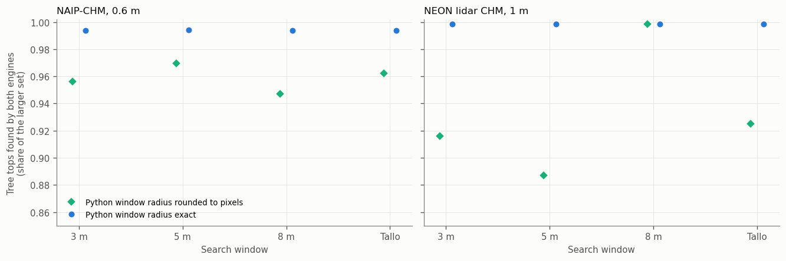
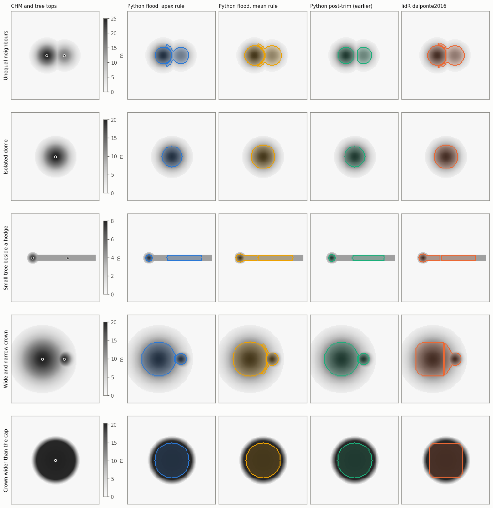
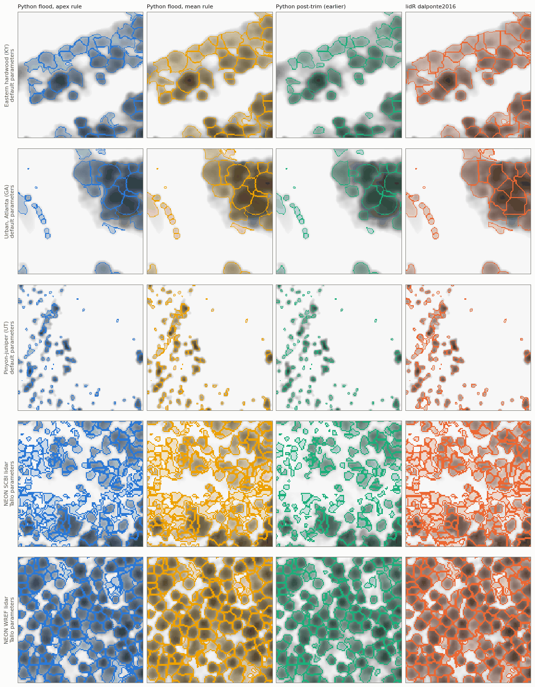
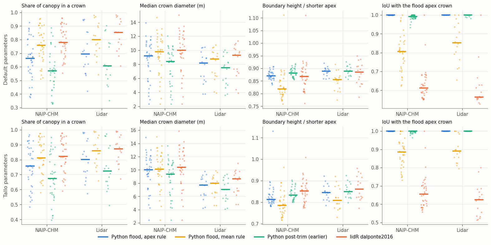
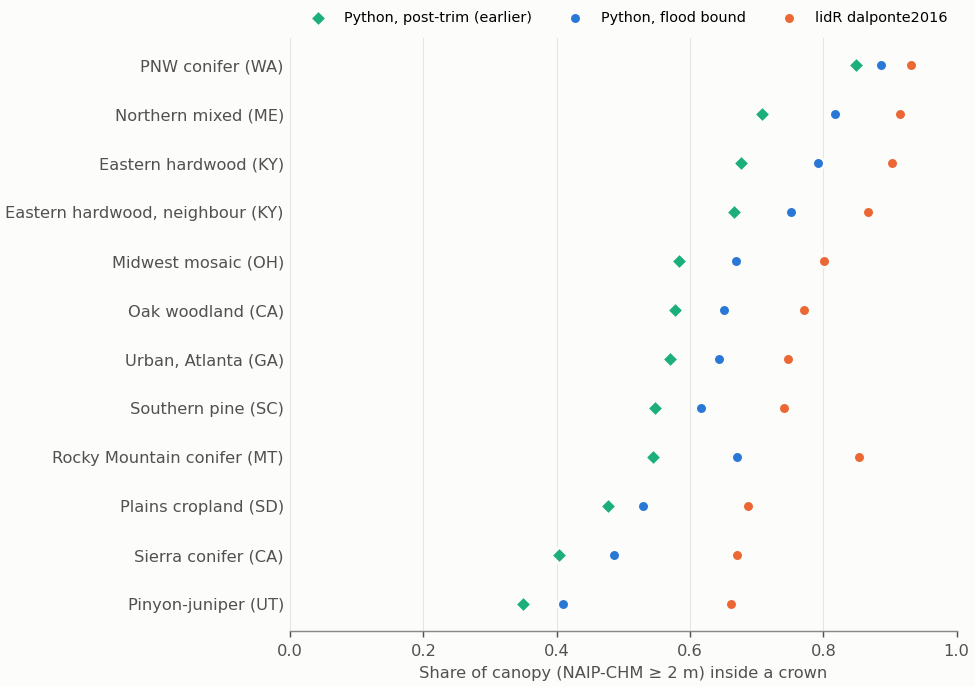
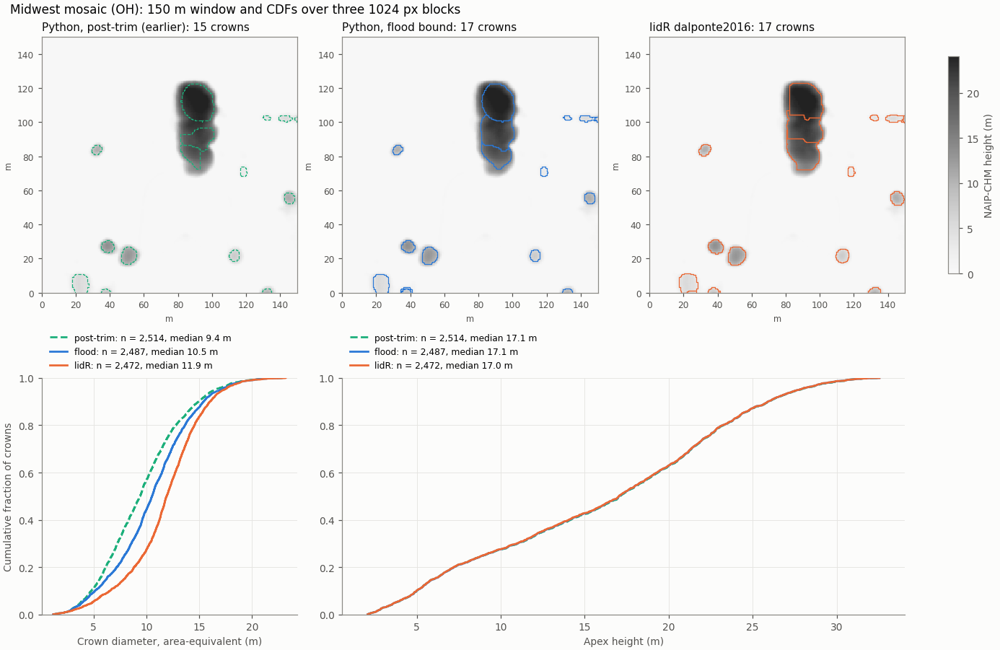
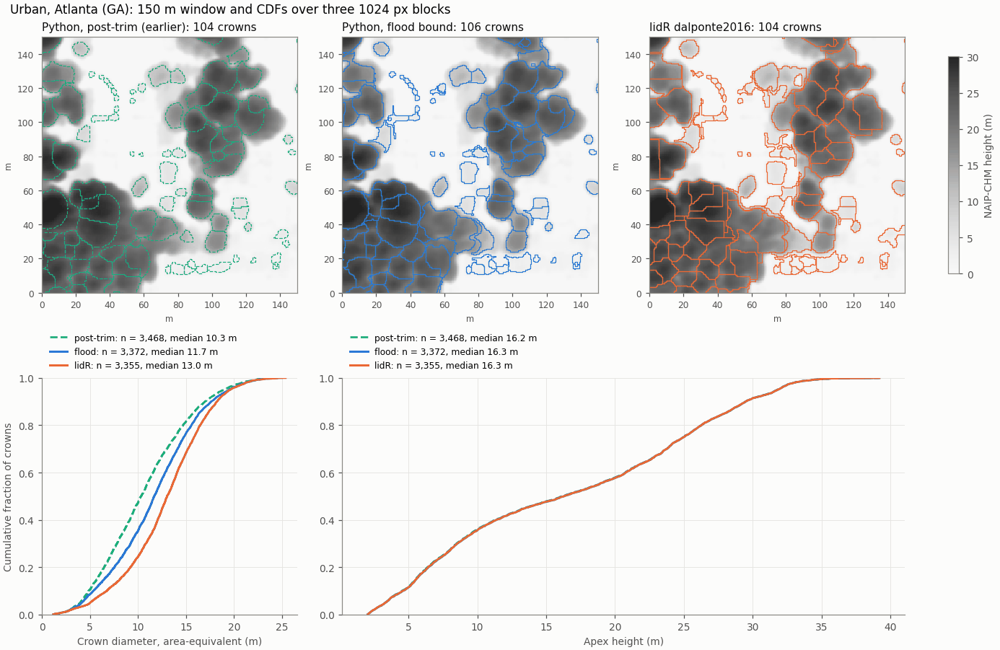
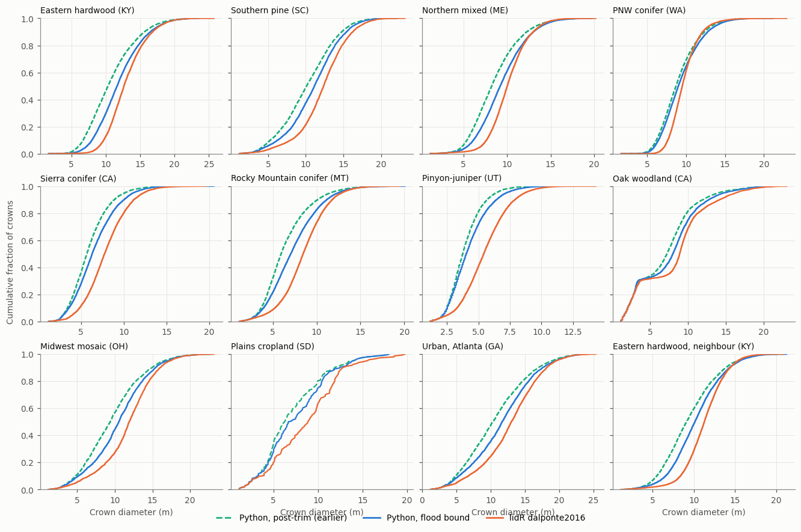
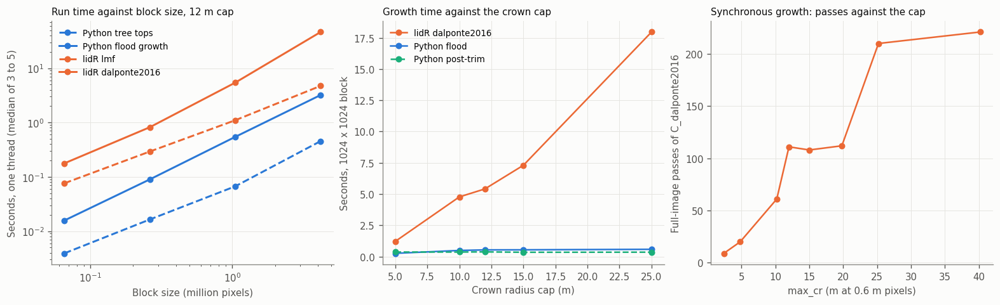
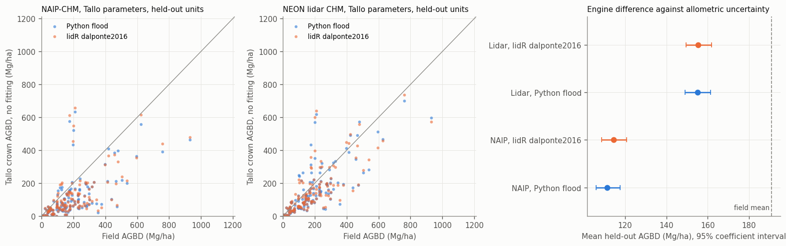

# Python against lidR

This page compares the Python engine with lidR's `lmf` tree detector and `dalponte2016` crown grower (lidR 4.3.0, Roussel et al. 2020) on identical inputs. It separates the two steps, so that each difference can be traced to a rule or to an implementation choice, and it reports run time, memory and the effect on crown-based aboveground biomass (AGB).

| Question | Finding |
| --- | --- |
| Do the two detectors find the same tree tops? | Yes. 99.4 to 99.9 percent coincide at the same pixel, and the rest are ties on plateaus. Python detects 5.5 to 12.8 times faster. |
| Do the growers make the same crowns from the same tree tops? | No. Median crown IoU between lidR and the Python apex rule is 0.57 to 0.66. Even under lidR's own rule, the Python flood and lidR agree only to 0.68 to 0.73, so lidR's implementation shapes crowns about as much as its rule does. |
| Which growth rule? | The Python default tests each pixel against a floor tied to its crown's apex height, which does not depend on growth order and puts boundaries in the valleys between crowns. lidR's floor is relative to the crown's running mean, so it falls as a crown grows. lidR also caps crowns with a square, gives contested pixels to the last crown scanned, and draws straight boundaries where growth fronts meet. |
| How much faster? | On one thread, Python takes 8 to 22 times less time for detection and growth together on 1 Mpx blocks. lidR's growth time rises with the crown cap (1.2 s at 5 m, 18 s at 25 m) because it makes one full-image pass per ring of growth. |
| Memory? | Similar: 384 to 396 MB against 444 to 463 MB per process on 1 Mpx blocks. |
| Does the engine change crown AGB? | Hardly. Held-out R² differs by at most 0.02 and mean AGB by 3 percent or less under the Tallo set, within the allometric coefficient uncertainty. The CHM matters far more: on NEON lidar crown AGB beats plot mean height (R² 0.58 to 0.60 against 0.51), on the NAIP-CHM it does not (0.38 to 0.41 against 0.50). |

## Inputs

**NAIP-CHM blocks.** 36 blocks of 1024 x 1024 pixels at 0.6 m (about 38 ha each) from 12 tiles of the national NAIP-CHM (Morford et al. 2026), chosen to span CONUS forest: eastern hardwood (two neighbouring tiles), southern pine, northern mixed, Pacific Northwest conifer, Sierra Nevada conifer, Rocky Mountain conifer, pinyon-juniper, California oak woodland, a Midwest woodlot mosaic, northern plains cropland and urban Atlanta. Each block is read with a halo, and metrics use the interior only. The list is in `scripts/segmentation/compare_lidr/strata_blocks.csv`.

**NEON lidar blocks.** 16 blocks of 1024 x 1024 m at 1 m from the NEON airborne lidar CHM (DP3.30015.001, through Earth Engine), one per NEON site with field plots, centred on the site's plots. JORN, with no canopy, is left out.

**NEON field plots.** 626 plots of 20 x 20 m at 17 sites, with field AGB, a fixed 491/135 calibration and validation split and mapped canopy trees, from the refAGB NAIP-CHM study. A chip of each CHM, plot plus a 50 m buffer, is cut for every plot.

**Same pixels.** Python smooths and masks each block once and writes it as a float32 GeoTIFF. lidR reads that file and smooths nothing, so both engines see identical pixels. Python runs on one thread. lidR runs on one thread unless stated, through `scripts/segmentation/compare_lidr/bench_lidr.R`, which loads R packages once and times each step inside the session. All timings are on one laptop core (Intel i7-1255U, WSL2).

## Tree detection

Both detectors apply the same rule: a pixel is a tree top when no pixel within `ws(h) / 2` metres is higher, where `h` is the pixel's own height. lidR's documentation describes `lmf` as "deeply inspired by Popescu & Wynne (2004)", the variable-window filter for lidar CHMs. Dalponte and Coomes (2016) themselves used a fixed window: "local maxima are located using a circular moving window" (Methods).

The implementations differ:

| | lidR `locate_trees(chm, lmf())` | Python `locate_seeds` |
| --- | --- | --- |
| Input | Every raster cell becomes a LAS point (`raster_as_las`) | The raster array |
| Search | One spatial-index query per point (`GridPartition`), circle test on exact distance | 3 x 3 maximum filter for candidates, then each candidate against its own disk in compiled code |
| Window radius | Exact, `ws(z) / 2` | Exact (`window_metric="exact"`); rounded to whole pixels in the earlier engine |
| Ties | The first point tagged wins, which depends on thread order | Tied maxima kept, each plateau collapsed to one top at its centre |
| Threads | OpenMP, with a critical section around each write | One |



*Share of tree tops that both engines find at the same pixel, for four windows: fixed 3, 5 and 8 m and the Tallo window of each block's biome. Green: Python with the window radius rounded to whole pixels, as the earlier engine did. Blue: exact distances.*

With exact distances the two detectors agree on 99.4 to 99.9 percent of tree tops, and Python finds 1.000 to 1.001 times as many. Every remaining difference but 0 to 23 per configuration is a plateau of tied heights where lidR keeps the first pixel it tags and Python keeps the plateau's centre. The NAIP-CHM is stored in whole centimetres, so ties are more common there than in the lidar CHM.

Rounding the radius to whole pixels, as the earlier engine did, was the main source of disagreement. `np.rint` rounds halves to even, so at 1 m the 3 m window (1.5 px) grew to 2 px and the 5 m window (2.5 px) shrank to 2 px, and the two windows found exactly the same 168,891 tree tops on the lidar blocks, where lidR found 184,087 and 150,047. On the NAIP-CHM, rounding gave 1.03 to 1.04 times lidR's count for 3 and 5 m windows, which is the 1.03 ratio the national feasibility study reported.

lidR's detection is not deterministic on more than one thread. Repeated with six threads, the same 5 m runs returned 2 different tree tops out of 150,047 on the lidar blocks and 6 out of 83,740 on the NAIP-CHM, all on plateaus. Six threads were also slower than one on the NAIP-CHM blocks (50 s against 36 s for all 36 blocks) and only 1.2 times faster on the lidar blocks.

Python's detector ran 5.5 to 12.8 times faster than lidR's on one thread. The gap widens with the window, because lidR queries a larger circle for every canopy pixel while Python checks only the 3 x 3 candidates.

| Window | NAIP-CHM, Python | NAIP-CHM, lidR | Lidar, Python | Lidar, lidR |
| --- | --- | --- | --- | --- |
| Fixed 3 m | 4.9 s | 27.1 s | 1.6 s | 11.0 s |
| Fixed 5 m | 4.9 s | 36.3 s | 1.5 s | 12.8 s |
| Fixed 8 m | 4.7 s | 59.8 s | 1.5 s | 17.0 s |
| Tallo | 5.3 s | 28.9 s | 1.8 s | 12.1 s |

*Total detection time over the 36 NAIP-CHM blocks (27 million canopy pixels) and the 16 lidar blocks (12.6 million), one thread.*

## Crown growth

### The rules

The two growers share the idea of Dalponte and Coomes (2016) and differ in four places that change crowns. Dalponte and Coomes describe the test in prose: neighbouring pixels "are added to the region if their vertical distance from the local maximum is less than some user-defined percentage of the local maximum height, and less than some user-defined maximum difference" (Methods). That is a floor relative to the tree top. lidR's `C_dalponte2016` tests against the running mean of the crown instead (`src/C_dalponte2016.cpp`, lines 101 to 107 at commit `b3c67d6`):

```cpp
expend =
  px.z > hSeed*th_seed &&
  px.z > mhCrown*th_crown &&
  px.z <= hSeed+hSeed*0.05 &&
  abs(seed.x-px.x) < DIST &&
  abs(seed.y-px.y) < DIST &&
  Region(px.x, px.y) == 0;
```

The Python flood (`src/csdv_core/segmentation/flood.py`) admits a neighbour to crown `L` when it is canopy, no higher than `1.05` times the apex, within the circular radius cap, and at or above the crown's fixed floor `max(th_seed H, min(th_cr H, H - min_crown_depth_m))`.

| | lidR `dalponte2016` | Python flood |
| --- | --- | --- |
| Floor | `th_cr` times the crown's current mean height, and `th_seed` times the apex | `th_cr` times the apex (optionally relaxed for short crowns), and `th_seed` times the apex |
| Order of growth | Whole-image passes, each adding one 4-connected ring to every crown, until a pass adds nothing | One heap, highest pixel first, across all crowns |
| Pixel claimed by two crowns in one pass | Goes to the crown scanned last, and is counted in the mean of every claimant | Goes to the first crown that reaches it and whose floor it passes, counted once |
| Pixel a crown rejects | Can be taken by another crown in a later pass | Stays free for another crown |
| Radius cap | Square: `abs(dx) < max_cr` and `abs(dy) < max_cr`, in pixels | Circle of `max_crown_radius_m` |
| Boundary between crowns | Where the growth fronts meet, roughly equidistant in pass count | Where the flood fronts meet, the lowest path between the crowns |
| Cost | Passes x pixels x `std::map` lookups | O(N log N) in canopy pixels, independent of the cap |

lidR documents `max_cr` as the "maximum value of the crown diameter of a detected tree (in pixels)", but the code uses it as a half-width: a crown reaches `max_cr - 1` pixels along each axis and further along the diagonals. A `max_cr` of 15 at 1 m, as the refAGB production runs use, is a square up to 29 m wide, not a 15 m crown.

The mean-relative floor relaxes itself. Each lower pixel a crown takes lowers its mean and so its bar, so a crown keeps growing down its flanks and across low canopy until `th_seed` or the cap stops it. The apex-relative floor does not move.

### Constructed scenes



*Five constructed CHMs (60 m across, 0.6 m pixels) grown from the same tree tops by four growers with `th_cr = 0.55` and `th_seed = 0.45`. The Python mean rule applies lidR's test inside the Python flood, which separates the rule from lidR's implementation.*

Each scene isolates one difference:

1. **Unequal neighbours.** The post-trim engine cuts the shared flank against the tall tree's floor and leaves a gap. The flood gives that flank to the shorter tree, whose floor it passes.
2. **Isolated dome.** The mean-relative rule (Python mean rule and lidR) grows 36 percent more pixels down the flanks than the apex rule.
3. **Small tree beside a hedge.** The 4 m hedge lies below the 8 m tree's apex floor (4.4 m) and above its `th_seed` floor (3.6 m). Under the mean-relative rule the tree's crown enters the hedge.
4. **Wide and narrow crown.** The Python boundary follows the valley around the narrow crown. lidR's boundary is a straight line where the two growth fronts met, and its square cap cuts the wide crown's sides.
5. **Crown wider than the cap.** lidR's cap is a square, the Python cap a circle.

### Real blocks

The same Python tree tops were grown by all four growers on every block, under the default parameters (`th_cr = 0.70`, 12 m cap) and the Tallo parameters (`th_cr = 0.55`, `th_seed = 0.45`, 15 m cap).



*A 120 m window of three NAIP-CHM blocks and two NEON lidar blocks. Identical tree tops in each row.*



*Per block (dots) and median (bars). Boundary height is the mean CHM height along the boundary between two crowns divided by the shorter crown's apex: boundaries that follow valleys sit lower.*

| Parameters | CHM | Grower | Canopy in a crown | Median crown diameter | Boundary height | IoU with flood, apex rule | IoU with flood, mean rule | Seconds per block |
| --- | --- | --- | --- | --- | --- | --- | --- | --- |
| Default | NAIP-CHM | Python flood, apex rule | 0.66 | 9.2 m | 0.87 | 1 | | 0.35 |
| Default | NAIP-CHM | Python flood, mean rule | 0.76 | 9.8 m | 0.82 | 0.81 | 1 | 0.39 |
| Default | NAIP-CHM | Python post-trim | 0.57 | 8.4 m | 0.88 | 0.99 | | 0.43 |
| Default | NAIP-CHM | lidR `dalponte2016` | 0.78 | 10.0 m | 0.87 | 0.61 | 0.73 | 4.67 |
| Default | Lidar | Python flood, apex rule | 0.69 | 8.2 m | 0.89 | 1 | | 0.39 |
| Default | Lidar | Python flood, mean rule | 0.80 | 8.7 m | 0.86 | 0.85 | 1 | 0.54 |
| Default | Lidar | Python post-trim | 0.61 | 7.5 m | 0.89 | 1.00 | | 0.56 |
| Default | Lidar | lidR `dalponte2016` | 0.85 | 9.3 m | 0.89 | 0.57 | 0.68 | 4.87 |
| Tallo | NAIP-CHM | Python flood, apex rule | 0.76 | 10.0 m | 0.81 | 1 | | 0.52 |
| Tallo | NAIP-CHM | Python flood, mean rule | 0.81 | 10.1 m | 0.79 | 0.89 | 1 | 0.66 |
| Tallo | NAIP-CHM | Python post-trim | 0.67 | 9.3 m | 0.83 | 1.00 | | 0.52 |
| Tallo | NAIP-CHM | lidR `dalponte2016` | 0.82 | 10.4 m | 0.85 | 0.66 | 0.71 | 5.86 |
| Tallo | Lidar | Python flood, apex rule | 0.80 | 7.7 m | 0.85 | 1 | | 0.70 |
| Tallo | Lidar | Python flood, mean rule | 0.86 | 8.0 m | 0.81 | 0.89 | 1 | 0.82 |
| Tallo | Lidar | Python post-trim | 0.72 | 7.0 m | 0.85 | 1.00 | | 0.54 |
| Tallo | Lidar | lidR `dalponte2016` | 0.87 | 8.6 m | 0.86 | 0.62 | 0.68 | 5.09 |

*Medians over 36 NAIP-CHM and 16 lidar blocks. IoU is the median intersection over union of crowns grown from the same tree top.*

Three results follow from the table.

**The rule matters.** At the same `th_cr`, the mean-relative rule assigns 5 to 11 percentage points more canopy than the apex rule and makes median crowns 0.1 to 0.6 m wider, because its floor falls as the crown grows. Neither is right in general. The apex rule is a statement about crown shape that does not depend on how a crown was grown, and `th_cr` alone controls how far down the flanks it reaches. The Tallo set, with `th_cr = 0.55` under the apex rule, assigns 0.76 of the NAIP-CHM canopy against 0.66 for the default set, close to the 0.78 lidR assigns under the default set.

**lidR's implementation matters as much as its rule.** Grown under the same rule, the Python mean rule and lidR agree on a median crown IoU of only 0.68 to 0.73, close to the 0.57 to 0.66 between lidR and the apex rule. lidR also places its boundaries higher on the crown flanks (0.85 to 0.89 of the shorter apex, against 0.79 to 0.86 for the same rule in the flood), because its boundaries form where synchronous growth fronts meet rather than along the lowest path between crowns. Its square cap, the last-scanned claimant, and the double counting of contested pixels in the crown mean all push in the same direction, and the constructed scenes show each.

**The flood fixes the earlier engine's loss.** Under the same apex rule, the flood assigns 8 to 9 percentage points more canopy than post-trim, with tree tops unchanged. Crowns that had no taller neighbour come out identical (median IoU 0.99 to 1.00), and the gain is concentrated in the saddles between crowns of unequal height.

Growing crowns took 0.35 to 0.82 s per block in Python and 4.7 to 5.9 s in lidR, 7 to 13 times as long as the Python flood.

## Before and after the flood bound

The Python engine itself changed during this work. It used to run an unconstrained watershed and then trim each crown to its floor (`bound_mode="post_trim"`), and it rounded the window radius to whole pixels (`window_metric="pixel"`). It now applies each crown's floor during the flood and uses exact window distances. On the 36 NAIP-CHM blocks, with the optimization study's parameters (`th_cr = 0.70`, fixed 5 m window, 12 m cap):

| | Earlier engine | Current engine | lidR |
| --- | --- | --- | --- |
| Canopy in a crown, by stratum | 0.35 to 0.85 | 0.41 to 0.89 | 0.66 to 0.93 |
| Canopy in a crown, median field plot | 0.77 | 0.86 | |
| Tree tops, relative to lidR | 1.01 to 1.03 | 1.000 to 1.007 | 1 |
| Crown diameter distance to lidR, KS | 0.23 to 0.42 | 0.13 to 0.32 | |
| Held-out R² of Tallo crown AGB, NAIP-CHM plots | 0.401 | 0.405 | 0.38 |
| Whole pipeline time, relative to lidR | | 1/7 to 1/13 | 1 |



*Share of each stratum's canopy (NAIP-CHM at or above 2 m) inside a crown, three blocks per stratum.*



*Midwest woodlot mosaic, Ohio. The earlier engine gave the saddles between the clump's three tree tops to the tallest tree and then cut them at that tree's floor, so much of the clump fell outside any crown. The flood gives those saddles to the shorter trees, whose floors they pass. CDFs are over all crowns of the stratum's three blocks.*



*Urban Atlanta. The straight boundary segments in the lidR panel are where its synchronous growth fronts met.*



*Crown diameter CDFs of all 12 strata. The current engine moves toward lidR without reaching it, because the remaining difference is the rule: an apex floor at 0.70 keeps less flank than a mean floor at 0.70.*

## Speed and memory

Each engine timed each step on crops of three NAIP-CHM tiles (dense eastern hardwood, Pacific Northwest conifer and open pinyon-juniper) from 256 x 256 to 2048 x 2048 pixels, on one thread, as the median of 3 to 5 runs. The R session loaded its packages once. Python ran each configuration in a fresh process, after compiling its Numba kernels.



*Left: time per step against block size with a 12 m crown cap, median of the three tiles. Centre: growth time against the cap on 1024 x 1024 blocks, dense hardwood tile. Right: full-image passes of `C_dalponte2016` against `max_cr`, counted with an instrumented local copy of the routine on the same block.*

| 1024 x 1024 block, 12 m cap | Python | lidR | lidR / Python |
| --- | --- | --- | --- |
| Tree tops | 0.065 to 0.070 s | 0.46 to 1.12 s | 7 to 17 |
| Crown growth | 0.05 to 0.77 s (flood) | 2.0 to 9.2 s | 7 to 44 |
| Both steps | 0.11 to 0.84 s | 2.5 to 10.4 s | 8 to 22 |
| Peak memory, process | 384 to 396 MB | 444 to 463 MB | |

At 2048 x 2048 pixels (4.2 million) lidR took 17 to 67 s to grow crowns against 0.3 to 4.6 s for the flood, and peaked at 808 to 858 MB against 632 to 742 MB. Both baselines are large: 253 MB for Python after imports, plus 47 MB for compiled kernels, and 270 MB for R with lidR, terra and sf loaded.

Four properties of lidR's implementation explain the gap, each visible in the measurements.

1. **Synchronous growth costs passes times pixels.** `C_dalponte2016` scans the whole image once per pass, adding one ring of pixels to every crown, and stops after a pass that adds nothing. The number of passes grows with `max_cr`: 9 passes at 4 pixels, 61 at 17, 111 at 20 and 221 at 67 on the dense 1024 x 1024 block, at about 80 ms per pass once crowns are large. Passes can exceed twice `max_cr` because crowns keep extending along winding lobes, and because a falling crown mean admits pixels in later passes that an earlier pass refused. Growth time therefore rose from 1.2 to 18.0 s as the cap went from 5 to 25 m, while the flood, which handles each pixel once from a heap, stayed between 0.27 and 0.59 s.
2. **The inner loop is expensive.** For every labelled pixel in every pass the loop looks up the crown's seed, height sum and pixel count in `std::map` containers, at logarithmic cost in the number of crowns, and it walks R's column-major matrices row by row. Each pass also copies the whole label matrix.
3. **Most time is in the C++ routine, so calling it directly would not help.** Under `Rprof`, `C_dalponte2016` accounted for 79 to 98 percent of growth time with caps of 10 m and more, and 46 to 69 percent with a 5 m cap, where the R wrapper's raster-to-matrix conversions, flips and seed rasterization are a larger share.
4. **Detection works on points, not pixels.** `locate_trees` converts every raster cell to a LAS point and queries a spatial index once per point with that point's own window. With a variable window lidR's shortcut for fixed windows is disabled, so the query runs for every canopy pixel. Python tests only the pixels that are 3 x 3 maxima. On six threads lidR's detection was slower than on one (1.74 to 1.83 s against 1.10 to 1.12 s on dense 1024 x 1024 blocks), because each write of the result sits in an OpenMP critical section.

The Python flood is itself slower than scikit-image's watershed, which the post-trim engine uses (0.54 s against 0.39 s on the dense block), because its heap is written in Numba rather than C. It is still 7 to 44 times faster than `dalponte2016` at the same cap.

## Crown AGB

Crown AGB was computed with the biome-wide Tallo models of the refAGB project, `ln(AGB) = a + b ln(H) + c ln(CD)` fitted to CONUS Tallo trees with allodb AGB (Jucker et al. 2022), from crown apex height and area-equivalent diameter, summed by tree top over each 20 m plot. Both engines used their own tree tops and crowns under the default and the Tallo parameter sets, on the NAIP-CHM chips and on the NEON lidar chips of the 626 plots. Skill is scored on the 135 held-out plots of the refAGB split.



*Left and centre: Tallo crown AGB density with no fitting against field AGB density, held-out plots, Tallo parameters. Right: mean held-out AGB density with the 95 percent interval from 1,000 draws of the model coefficients from their covariance.*

| CHM | Predictor | Held-out R², line fitted on calibration plots | Bias with no fitting |
| --- | --- | --- | --- |
| NAIP-CHM | Plot mean height | 0.50 | |
| NAIP-CHM | Crown AGB, Python, default / Tallo set | 0.41 / 0.40 | −46 / −42 percent |
| NAIP-CHM | Crown AGB, lidR, default / Tallo set | 0.38 / 0.38 | −43 / −40 percent |
| NEON lidar | Plot mean height | 0.51 | |
| NEON lidar | Crown AGB, Python, default / Tallo set | 0.60 / 0.58 | −27 / −19 percent |
| NEON lidar | Crown AGB, lidR, default / Tallo set | 0.60 / 0.58 | −23 / −19 percent |

The two engines are interchangeable for AGB. Their held-out R² differ by at most 0.02, and under the Tallo set their mean held-out AGB density differs by 3 percent on the NAIP-CHM (111 against 114 Mg/ha) and by less than 1 percent on lidar (155.0 against 155.4 Mg/ha), inside the 95 percent coefficient interval of about plus or minus 5 percent in each case. Under the default set the difference is 5 to 6 percent, because lidR's mean-relative rule makes crowns larger there.

The CHM matters far more than the engine. On lidar, crown AGB beats a line on plot mean height (R² 0.58 to 0.60 against 0.51), and with no fitting at all it explains about half the variance. On the NAIP-CHM crown AGB loses to mean height (0.38 to 0.41 against 0.50) and underestimates field AGB by 40 to 46 percent, because the NAIP-CHM shows about one crown per 3.5 canopy trees and hides the subcanopy. A multiplicative correction fitted on the calibration plots removes that bias but leaves held-out R² below zero on the NAIP-CHM: a single factor cannot repair crowns that stand for a varying number of trees.

## Limitations

The comparison measures agreement, consistency and cost, not accuracy against delineated crowns. No crown-level reference exists for these blocks, and on the NAIP-CHM the crowns are canopy patches of several trees, so a field crown is not a fair target there. The field plots score crown AGB, which is what the crowns are used for in this project.

Timings come from one laptop core. Absolute times on a cluster core will differ, while the ratios between the engines, which arise from algorithmic cost, should travel better. lidR times exclude starting R and loading packages (about 1 to 2 s per `Rscript`), which a workflow that starts R for every tile pays on top.

The lidar blocks are NEON's own CHM product, not the point-to-raster CHM that the refAGB production runs build from the point clouds, so the refAGB crowns themselves are not reproduced here. The Tallo parameter set is reproduced in metres rather than in pixels.

The constructed scenes illustrate each difference. Their magnitudes depend on the parameters chosen and say nothing about how often each case occurs. The boundary-height measure is a heuristic for whether a boundary follows the valley between two crowns.

## Reproducing

```bash
export REFAGB_METHODS_DIR=<refAGB methods-paper repository>
P=.micromamba/envs/CSDV/bin/python
D=scripts/segmentation/compare_lidr
$P $D/fetch_units.py naip        # NAIP-CHM chips of the 626 plots, ~5 min
$P $D/fetch_units.py neon        # NEON lidar chips of the plots, ~1 min (Earth Engine)
$P $D/fetch_units.py blocks      # NEON lidar blocks, ~1 min (Earth Engine)
$P $D/before_after.py select     # flood defaults, ~7 min
$P $D/before_after.py units      # ~2 min
$P $D/before_after.py strata     # ~10 min, needs lidR
$P $D/compare.py detect          # ~6 min
$P $D/compare.py grow            # ~15 min
$P $D/compare.py synthetic       # ~1 min
$P $D/compare.py speed           # ~12 min
$P $D/compare.py agb             # ~15 min
$P $D/figures.py                 # writes figures/ here
```

lidR runs need R with lidR, terra and sf (`r-base r-lidr r-terra r-sf` from conda-forge). Tables go to `results_root/segmentation_compare/tables/`.

## References

Dalponte, M. and Coomes, D. A. (2016). Tree-centric mapping of forest carbon density from airborne laser scanning and hyperspectral data. *Methods in Ecology and Evolution* 7, 1236-1245.

Jucker, T. et al. (2022). Tallo: A global tree allometry and crown architecture database. *Global Change Biology* 28, 5254-5268.

Morford, S. L., Allred, B. W., Coons, S. P., Marcozzi, A. A., McCord, S. E., Smith, J. T. and Naugle, D. E. (2026). A 0.6-meter resolution canopy height model for the contiguous United States. *Scientific Data*, doi:10.1038/s41597-026-07549-w.

Popescu, S. C. and Wynne, R. H. (2004). Seeing the trees in the forest: using lidar and multispectral data fusion with local filtering and variable window size for estimating tree height. *Photogrammetric Engineering and Remote Sensing* 70, 589-604.

Roussel, J.-R. et al. (2020). lidR: An R package for analysis of Airborne Laser Scanning (ALS) data. *Remote Sensing of Environment* 251, 112061.
